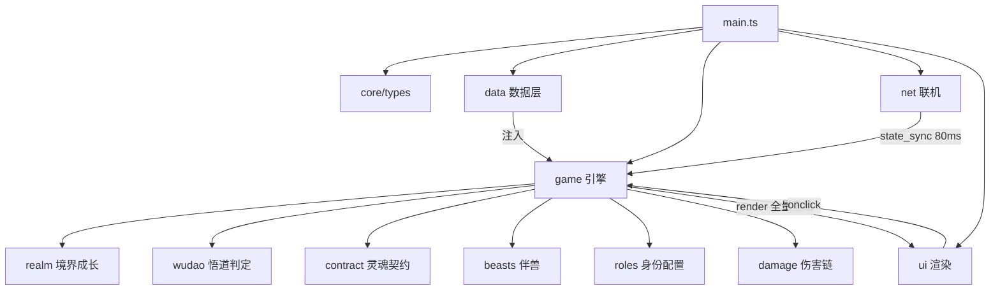

# 掌门杀 · 架构设计

工程迁移自 `D:\code\game\learn_kill`（学堂杀）的模块骨架，保持其关键不变量；数据层与主题层做修真化重写。

---

## 一、技术栈

| 层 | 选型 |
|---|---|
| 语言 | TypeScript 5.6（strict） |
| 构建 | Vite 5 + `vite-plugin-singlefile` |
| 运行时 | 无框架；字符串模板 `innerHTML` + 单一状态对象 `G` 全量重绘 |
| 联机 | PeerJS 1.5（P2P 房主权威），`#peer` alias 双模式 |
| 样式 | 纯手写 CSS（`src/style.css` + CSS 变量 token），**不引入 Tailwind CDN** |
| 测试 | esbuild 驱动的 Node 冒烟脚本 |

**为什么不用 Tailwind CDN**：bundled 产物要求「双击即玩、可离线联机」，外链 CDN 会破坏自包含性。以等效手写 CSS 达成同等质感。

---

## 二、模块结构

```
src/
├── main.ts              唯一副作用入口：挂载 window 全局 + 初始化序列
├── globals.d.ts         模板 onclick 函数的全局声明
├── style.css            仙侠水墨玉青鎏金皮肤
├── core/                types（领域类型+NetMessage）/ dom / shuffle / sound / fx
├── data/                camps / powers / regions / lingdi / realms / roles /
│                        contracts / characters / beasts / daoVerses /
│                        cards / cardCatalog / spellTricks / skilldefs
├── game/                state / rules / realm / wudao / contract / roles /
│                        beasts / damage / actions / skills / skillEngine /
│                        turn / ai / loop / choice / marks / log / chat / setup
├── net/                 protocol / network / rooms / peer.cdn / peer.bundled
├── profile/             profile（localStorage）
├── ui/                  render / lobby / playzone / hand / modals / settle
└── types/               peerjs.d.ts
```

---

## 三、关键不变量（继承自 learn_kill）

1. **`G` 字段形状冻结** —— `state_sync` 直接序列化 `G`，客户端结构化解包；新增字段一律「可空 + 增量追加」
2. **模板引用必须挂载** —— 模板字符串中调用的函数必须在 `main.ts` 挂 `window` 并在 `globals.d.ts` 声明，否则运行时报 undefined
3. **模块循环引用安全** —— 仅 `main.ts` 有顶层副作用；其余模块顶层禁止副作用
4. **共享可变状态单一所有权** —— `logs` / `chat` / `ROLE_MARKS` / `SELECTED_*` 只经各自模块的 mutator 修改
5. **魔法数字承载语义** —— 80ms 同步防抖、6 位房号、牌堆构成等集中为常量
6. **产物必须自包含** —— `verify:dist` 作为 CI 门禁

---

## 四、数据流



### 选人流程

选阵营 → 选地域／势力 → 选角色（兽类走灵兽池）→（御兽门）择伴兽 → 勾选身份池 → 配置器按人数分配 → 开局

### 回合流程

判定 → 摸牌 2 → 出牌 → 弃牌 → 回合末「闭关」

### 悟道流程

打出【悟道】卡（扣 1 灵力）→ 翻判定牌 → 红成功（修为 +4、道心 +1、诗词感悟）→ 修为与灵地阶位双达标则境界突破

### 契约流程

打出【灵魂契约】卡 → 指定对象 → 双方留真名于羊皮纸 →「凉风扫过」成立 → 心头锁 → 背盟则尖头鬼影现于印堂、灵魂反噬

---

## 五、收敛点设计

为避免结算逻辑散落导致状态不一致，关键逻辑各自收敛到单一入口：

| 收敛点 | 位置 | 职责 |
|---|---|---|
| `gainXiuwei()` | `game/realm.ts` | 所有修为获取的唯一入口（含灵根纯度修正） |
| `canBreakthrough()` | `game/realm.ts` | 突破双前置条件判定（修为 + 灵地 + 上限） |
| `breakthroughRealm()` | `game/realm.ts` | 突破收益集中结算 |
| `canUseWudao()` / `judgeWudao()` | `game/wudao.ts` | 悟道条件与判定 |
| `breakContract()` | `game/contract.ts` | 灵魂反噬唯一结算点 |
| `applyDamage()` | `game/damage.ts` | 伤害链唯一入口（伴兽承伤只在此） |
| `composeRoles()` / `settleRoles()` | `game/roles.ts` | 身份配比与胜负结算 |

---

## 六、联机：房主权威

- 房主运行游戏循环，`broadcastState()` 以 **80ms 防抖**广播 `state_sync`
- 远程玩家的选择经 `choice_request` / `choice_response` 回传房主执行
- **掉线自动转 AI**：连接 `close` 时把该席位 `ai = true`
- **中途接管**：新连接优先分配 AI 空位
- 客户端只读渲染，不本地推演（避免各端随机不一致——尤其悟道翻牌）

---

## 七、构建管线

```
npm run build:cdn      → dist/掌门杀.html          （PeerJS 走 CDN，约 174 KB）
npm run build:bundled  → dist/掌门杀.bundled.html  （内嵌 peerjs，约 260 KB，可离线联机）
npm run verify:dist    → 自包含单文件 + 双模式差异校验
```

`vite.config.ts` 通过 `VITE_PEERJS_MODE` 控制：alias `#peer` 切换实现、是否注入 CDN script、产物重命名。

---

## 八、测试

| 命令 | 覆盖 |
|---|---|
| `npm run typecheck` | TS strict 全量检查 |
| `npm run smoke` | 单机对局闭环（开局 → AI 对局 → 结算） |
| `npm run smoke:cards` | 牌堆构成 + 术语合规 |
| `npm run smoke:roster` | 角色名册（116 人）：唯一性 / 引用完整性 / 阵营分布 / 术语合规 |
| `npm run smoke:roles` | 身份池与人数配比 |
| `npm run smoke:contract` | 灵魂契约（立约 / 背盟 / 公正鬼） |
| `npm run smoke:wudao` | 境界成长与悟道判定（含灵地门槛） |
| `npm run smoke:net` | 联机协议（房间号 / 编解码 / 快照序列化） |
| `npm run verify:dist` | 产物自包含校验 |

冒烟脚本经 `scripts/smoke-lib.mjs` 用 esbuild 把 TS 检查脚本打包后在 Node 运行，并注入最小 DOM 桩，无需浏览器。

---

## 九、AI 双机制（启发式 + 大模型接管）

移植自 learn_kill 的「决策提供者」架构，零死锁、可回退：

- **启发式**（`game/ai.ts`）：`enumerateActions` 按优先级枚举当前合法动作 → `executeAction` 执行；博弈式目标评分（`aibrain.ts` 信念推断）决定攻击目标。
- **大模型接管**（`llm/`）：`config`（localStorage，OpenAI 兼容）→ `client`（fetch + timeout）→ `agent`（决策路由 + 坏决策降级）→ `prompts`（上下文拼装）。
- **切换点**：`setup.applyLlmModes()` 依据配置把各 AI 座位标 `aiMode: 'llm' | 'heuristic'`；`ai.aiPlay` 在 `aiMode==='llm'` 且 `llmReady()` 时调用 `llmChooseAction` / `llmPlanActions`，否则走启发式。
- **零死锁保证**：大模型过慢（接近超时）或异常/输出非法 → 计坏决策，累计达阈值 `demoteLlmSeat` 本局降级；单步失败则 `heuristicLoop` 兜底。
- **单机 / 联机通用**：房主跑循环，AI 座位由房主统一决策；联机客人为只读（随 `state_sync` 自动同步 `aiMode`）。
- **上下文硬约束**：Prompt 不泄露他人手牌与未揭示身份；信念摘要来自 `aibrain` 的观察（谁攻击谁），非上帝视角。

### 模块结构新增

```
src/llm/      types / config / client / agent / prompts   —— 大模型接管决策链
src/game/aibrain.ts                                      —— 信念推断 + 博弈策略
src/ui/theme.ts                                          —— 主题系统（光线×配色）
src/ui/llmSettings.ts                                    —— 大模型设置界面
```

---

## 十、主题与响应式

- **主题**：`body[data-mode]`（day/night/dusk）× `body[data-theme]`（jade/gold/azure/purple/red/green），由 CSS 变量驱动；选择持久化于 `profile`，首帧内联脚本兜底避免闪现。
- **响应式**：桌面三栏（牌桌 / 战报 / 聊天）在 ≤768px 折叠为单列、≤620px 进一步压缩顶栏/角色网格/手牌行，确保手机可直接开局。
- **对局双形态**：大屏（>768px）为**椭圆牌桌**——座位沿环绝对定位（`playzone.ts` 写内联 `left/top`）；小屏（≤768px）回落**列表方式**——CSS 以 `!important` 覆盖内联坐标使座位回归网格流。二者配套，详见 [游戏机制.md 第十一节](./游戏机制.md)。

| 冒烟 | 覆盖 |
|---|---|
| `npm run smoke:ui` | 浏览器加载 / 大厅 / 116 人网格 / 开局 / 主题与大模型面板 / 牌桌↔列表双形态 / 移动端响应式 / 零控制台错误 |

---

## 十一、文档索引

| 文档 | 内容 |
|---|---|
| [README.md](./README.md) | 游戏文档索引与快速开始 |
| [游戏机制.md](./游戏机制.md) | 身份系统、灵魂契约、境界成长、卡牌与法宝、回合流程、结算优先级、术语禁用清单、角色名册、对局形态与 AI 决策 |
| [玩法.md](./玩法.md) | 面向玩家的上手指南 |
| [卡牌.md](./卡牌.md) | 卡牌完整参考（138 张） |
| [../../README.md](../../README.md) | 项目入口（特性、命令、工程架构） |
| [../../AGENTS.md](../../AGENTS.md) | AI 协作指南与关键不变量 |
| [../../CHANGELOG.md](../../CHANGELOG.md) | 版本变更记录 |

---

## 十二、动效层（FX）

参考 `learn_kill` 的动效体系，以**仙侠水墨 + 鎏金**重绘；全部集中在 `src/core/fx.ts` 与 `style.css` 的「特效层」区块。

| 事件 | 特效 | 触发点 |
|---|---|---|
| 出神通 | 剑意突进（攻击者前倾）+ 剑气斩击（剑/炎/雷三色）+ 受击震颤 + 扣血飘字 | `actions.playShengtong` / `damage.applyDamage` |
| 打出护身 | 护体灵光（金青灵罩 + 「护」字） | `actions.playShengtong` |
| 灵丹 / 回寿 | 生机涟漪 + 「回春」 | `damage.heal` |
| 火系 / 雷系伤害 | 全屏同色闪光 + 震屏 | `damage.applyDamage` |
| 摸牌 / 弃牌 | 牌堆 ⇄ 座位飞牌 | `turn.drawPhase` / `discardPhase` |
| 符篆 / 秘术 | 符纸展开（符 + 卡名）+ 阵纹旋转 | `actions.playTrick` |
| 阵法群攻 | 冲击波扩散 + 逐目标震颤 | `actions.playTrick`（十方/万剑/三木） |
| 悟道 | 五行翻牌（♠水♥火♣木♦金）+ 金光「道心澄明」/ 灰雾「心魔滋生」 | `actions.playWudao` |
| 境界突破 | 金光柱 + 旋转光轮 + 「破境」 | `actions.playWudao` |
| 装备法宝 | 名称飞入 | `actions.equipFaqi` |
| 灵魂契约 | 凉风扫过（青白流光横贯双方）+ 心头锁落下 | `contract.signContract` |
| 背盟反噬 | 尖头鬼影现于印堂 | `contract.breakContract` |
| 伴兽溃散 | 灵光崩散（八向粒子） | `beasts.beastAbsorb` |
| 主动技 | 法术涟漪 | `skillEngine.useSkill` |
| 陨落 | 元神离体（「陨落」+ 身份揭示） | `damage.dyingPhase` |
| 结算 | 胜负横幅 + 胜利个性动画（正道金光 / 外道血焰 / 隐匿紫雾 / 败北碎片） | `ui/settle.ts` |

**硬约束**

- 所有特效经 `push()` 统一挂载 `#fxLayer`，`isSim()` 时直接返回：无头冒烟不产生 DOM、不阻塞、不改结算。
- 特效函数均为**同步 void**，不在游戏逻辑里 `await`。
- `seatAnchor` / `elAnchor` 对缺失 `getBoundingClientRect` 的桩对象做兜底，避免测试环境抛错。
- 新增特效只加视觉，**不得修改任何结算分支**。

### UI 细节（对齐 learn_kill）

| 项 | 实现 |
|---|---|
| **音效** | `core/sound.ts`：WebAudio 五声音阶合成，零音频资源；覆盖点击/摸牌/出牌/神通/护身/灵丹/灵药/弃牌/法宝/符篆/阵法/回春/定身/斗法/技能/悟道/破境/反噬/契约/受击/治疗/判定/陨落/回合/胜负；`isSim()` 静默 |
| **出牌区** | `core/fx.ts` 的 `playCardFx(seat, card, owner)`：打出的牌浮现于 `#playZoneCards`（花色 / 点数 / 牌名 / 归属，最多 4 张，2.2s 淡出）；由 `actions.playCard` 包一层统一触发 |
| **身份标记** | 座位卡 🏷（自身不显示）→ `openMarkMenu(seat)` → `game/marks.ts` 的 `ROLE_MARKS` 渲染 `p-mark-label` 标签 + `role-marked` 外环 |
| **卡牌态** | `.card.clickable` 金色呼吸脉冲（本人出牌阶段可出）、`.trick-tag` / `.equip-tag` 牌型配色、`.card-disabled` 置灰禁点、`.action-hint.hint-target` 选牌提示 |
| **结算页** | 胜利演出（按阵营金光 / 血焰 / 紫雾 / 碎片，`victoryFx(camp, 'settleHero')` 挂载于 `#settleHero`）+ 本人名片 + 四项统计卡 + 战绩表（玩家/身份/阵营/境界/灵地/寿元/状态） |
| **聊天** | 微信式气泡：头像 + 昵称 + 气泡；自己右对齐、蓝色气泡（`chat-msg.self`） |
| **战报** | `.play-log-item` + `HH:MM` 时间戳 + 类型左侧色条（system / backlash / contract / breakthrough） |
